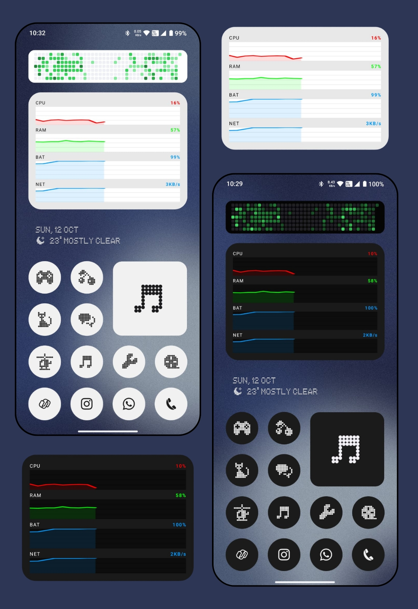

# RTMON

A real-time system monitoring widget for Android. Shows live CPU, RAM, battery, and network stats directly on your home screen — with color-coded graphs and a retro LED Dot-Matrix aesthetic.



---

## Features

- Live CPU, RAM, battery, and network speed monitoring
- Color-coded line graphs with 60-second history
- LED Dot-Matrix font
- Automatic light and dark theme support
- 3-second refresh rate, zero drain when screen is off
- Widget only — no app UI

---

## Install

**Pre-built APK** — grab the latest release from [Releases](https://github.com/n1th1n-19/RTMON/releases) and sideload it.

**Build from source** — requires Android Studio and JDK 11+:

```bash
git clone https://github.com/n1th1n-19/RTMON.git
cd RTMON/android
./gradlew assembleRelease
```

APK output: `app/build/outputs/apk/release/app-release.apk`

---

## Add to Home Screen

1. Long-press your home screen
2. Tap **Widgets**
3. Find **RTMON** and drag it on

---

## Customization

All customization is done by editing source files and rebuilding.

**Refresh rate** — `SystemStatsWidget.kt`, inside `startRealtimeUpdates()`:

```kotlin
3000L  // interval in milliseconds
```

**Graph history** — `SystemStatsWidget.kt`:

```kotlin
private const val MAX_DATA_POINTS = 20  // 20 points × 3s = 60s
```

**Colors** — `res/values/colors.xml` (light) and `res/values-night/colors.xml` (dark):

```xml
<color name="widget_background">#E8E8E8</color>
<color name="widget_graph_background">#FFFFFF</color>
<color name="widget_grid">#D0D0D0</color>
<color name="widget_label_text">#000000</color>
```

---

## Performance

| Metric | Value |
| --- | --- |
| Refresh rate | 3 seconds |
| Cycle time | 20–35 ms |
| Memory per update | ~30–40 KB |
| CPU overhead | 0.3–0.8% |
| Battery drain | ~1.5–2% / hr (screen on) |
| Battery drain (screen off) | 0% |

---

## Troubleshooting

**Stats frozen** — disable battery optimization: Settings → Apps → RTMON → Battery → Unrestricted

**Widget missing** — reinstall the APK, then re-add the widget

**Build failed** — clean and retry:

```bash
cd android
./gradlew clean assembleRelease
```

**Check logs:**

```bash
adb logcat | grep SystemStatsWidget
```

---

## Limitations

- Android only
- Network speed is device-wide, not per-app
- Dark/light auto-switching requires Android 10+

---

## Roadmap

See [ROADMAP.md](ROADMAP.md) — Nothing Phone Glyph Interface integration is planned.

---

## License

MIT — see [LICENSE](LICENSE)
